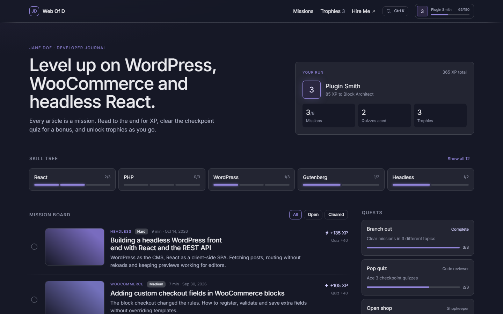
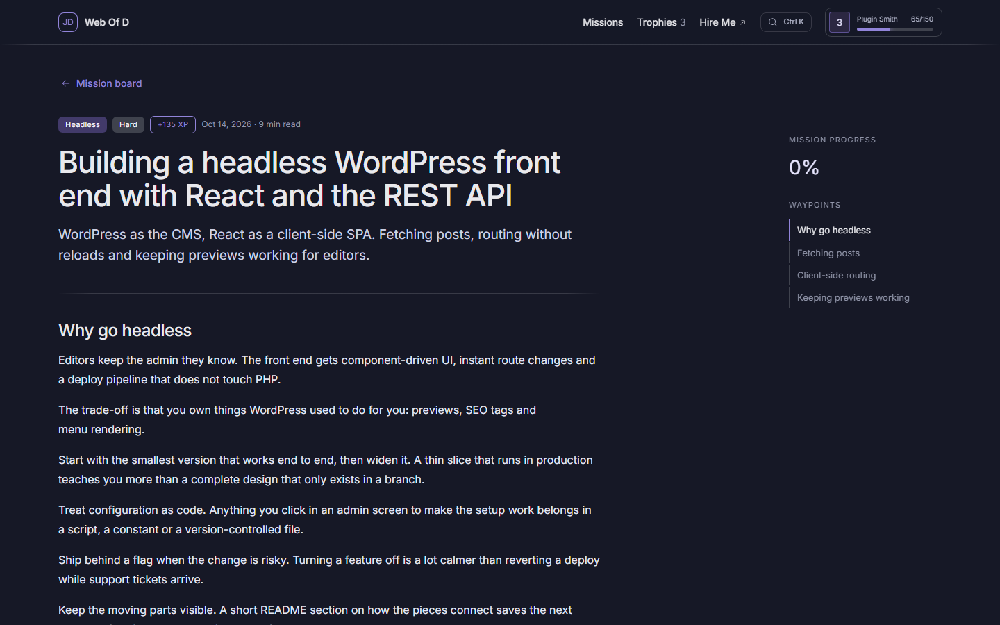
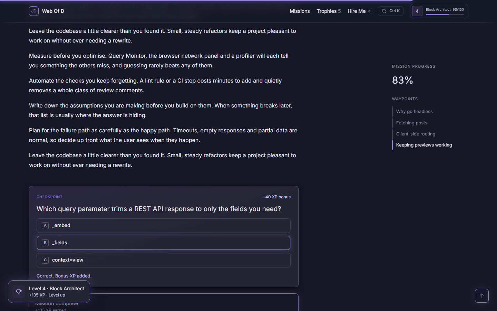
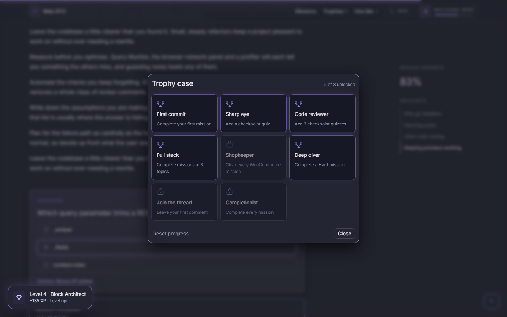
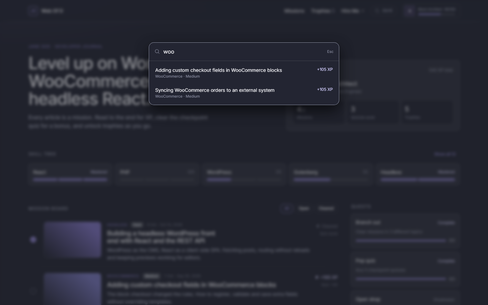
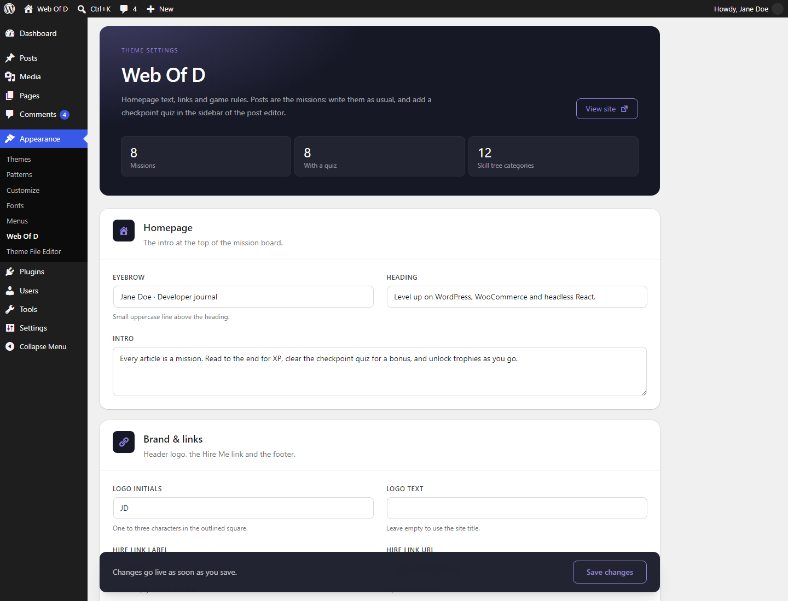
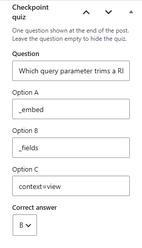
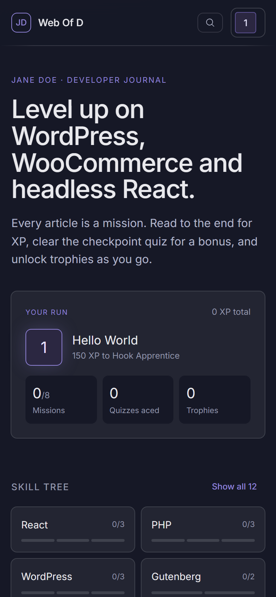

# Web Of D

A gamified developer-blog theme. Every post is a mission: readers earn XP for reading to the end, acing a one-question checkpoint quiz and commenting, level up through ranks and unlock trophies. Progress lives in the reader's browser (`localStorage["wod-game-v1"]`).

The UI is a React app (Vite, Tailwind 4, Nocturne design tokens). WordPress owns the URLs and content. Every view (board, category, post, page, 404) prints `window.wodData` from `inc/data.php`, and React renders it into `#wod-app`. A `<noscript>` fallback keeps content readable without JavaScript. No plugins are required.

## Screenshots

| | |
| --- | --- |
|  |  |
| **Post:** tags, difficulty, XP and read time, with Waypoints (table of contents) and reading progress in the sidebar. | **Checkpoint quiz:** one try per post. A correct answer adds bonus XP; reaching the end of the post clears the mission. |
|  |  |
| **Trophy case:** eight trophies, locked ones dimmed, plus a progress reset. | **Search:** Ctrl+K (⌘K on Mac) filters missions by title, excerpt and category as you type. |
|  |     |
| **Settings:** Appearance → Web Of D for homepage copy, links, game rules, navigation and performance. | **Quiz meta box** in the post editor, and the board on a phone. |

## WordPress additions

- `wod_quiz` post meta (`{question, options[3], answer}`), editable in a native **Checkpoint quiz** meta box and exposed in REST (`meta.wod_quiz`).
- `read_minutes` REST field on posts (words / 200, rounded up).
- `rest_allow_anonymous_comments`, so guests comment through `POST /wp/v2/comments`.
- `wod-card` image size (336×210, cropped).
- The mission topic is the post's first category, or its Yoast / Rank Math primary category when one is set. The "Open shop" quest and "Shopkeeper" trophy use the `woocommerce` category slug.

## Settings

**Appearance → Web Of D** (`inc/options.php`, stored in the `wod_options` option):

- **Homepage:** eyebrow, heading and intro.
- **Brand & links:** logo initials and text, the Hire link, the footer name and the GitHub link.
- **Game:** XP per level, skill cards shown, auto-complete, quizzes, waypoints and the shop category.
- **Navigation:** turn instant page changes on or off.

Fields are defined once in `wod_option_fields()`. To add one, add it there, then expose it in `wod_site_data()` or `wod_game_config()` (`inc/data.php`). **Appearance → Menus → "Header links"** adds extra header links after Trophies. The `wod_site` filter can still override any of this.

## Navigation (SPA)

After the first load, React Router (`BrowserRouter`, with the WordPress home path as the basename) handles navigation. `src/components/SpaLinks.jsx` intercepts every same-site link, including links inside post content. It prefetches posts on hover and restores the scroll position on back/forward.

- The board and category boards render instantly from `window.wodData`.
- Posts and pages load from `GET /wp-json/wod/v1/view?url=…` (`inc/rest.php`), which returns the same payload the page itself prints. A skeleton shows while they load.
- Anything else falls back to a normal page load: wp-admin, feeds, files, searches, tag archives, and URLs WordPress has no post for.
- Add `data-reload` to a link to force a normal load.

## Commands

| Command | What it does |
| --- | --- |
| `npm run dev` | Vite dev server with HMR (writes `hot`; Ctrl+C removes it) |
| `npm run build` | Builds `dist/` (the live site serves from it) |
| `npm run lint` | ESLint |
| `npm run env:start` / `env:stop` | Local WordPress via wp-env (Docker) at http://localhost:8888, admin / password |
| `npm run seed` | Activates the theme in wp-env and creates 8 demo missions with categories, quizzes, comments and featured images (dev only, not in the zip) |
| `php scripts/seed.php https://your-site.test` | Same demo content on a local install without WP-CLI (theme must be active). Leaves site title, permalinks and users alone. The URL is only needed when `wp-config.php` builds the site URL from the request (`$_SERVER['HTTP_HOST']`); otherwise it can be left off |
| `npm run version:patch\|minor\|major` | Bumps `style.css`, `WOD_VERSION` and `package.json` |
| `npm run bundle` | Builds and writes `web-of-d-vX.Y.Z.zip` |
